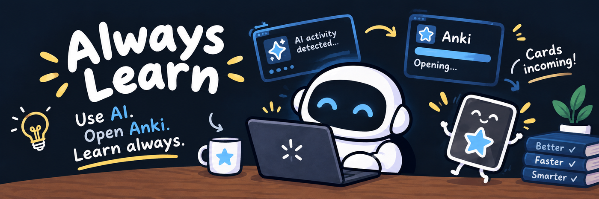
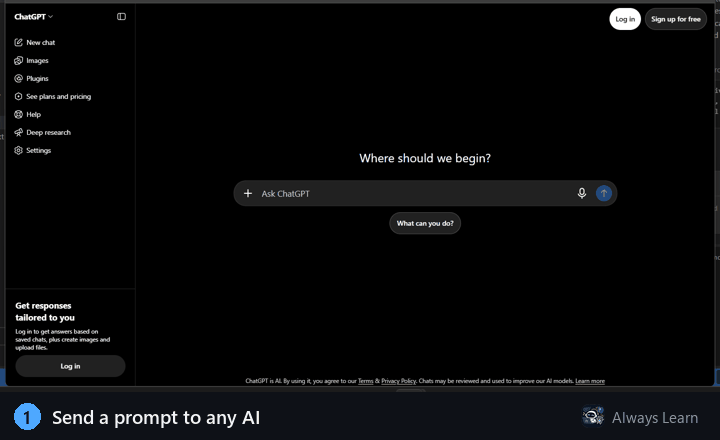
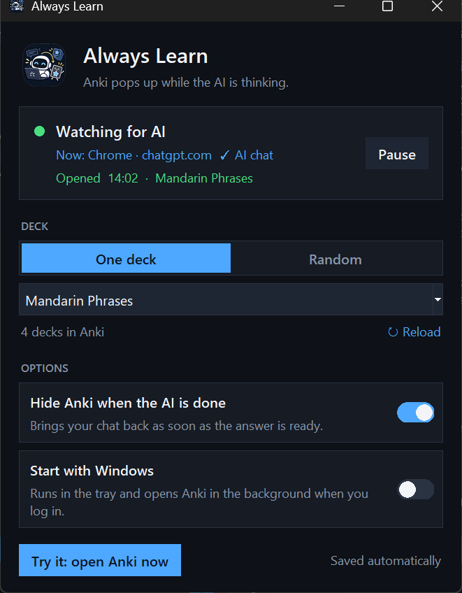

# Always Learn



While the AI is thinking, you usually scroll or get distracted. Always Learn
puts that time to use: **when you send a prompt, Anki pops up with a card.
When the AI finishes answering, Anki hides and your chat comes back.**

Works with ChatGPT, Claude, Gemini, Copilot, Perplexity, DeepSeek, Grok and
more, in any major browser or in the desktop apps. Windows only.





## Install

1. Install [Anki](https://apps.ankiweb.net/) and its
   [AnkiConnect](https://ankiweb.net/shared/info/2055492159) add-on
   (in Anki: **Tools → Add-ons → Get Add-ons…**, code `2055492159`).
   Restart Anki.
2. Download **always-learn.exe** from the
   [Releases page](https://github.com/EduSR9/always-learn/releases) and
   double-click it. Windows may warn about an unknown app: click
   **More info → Run anyway**.
3. Pick your deck and click **Try it: open Anki now**.

A desktop shortcut is created the first time you run it. Turn on **Start with
Windows** so you never forget to open it.

## Using it

| | |
|---|---|
| **Pause / Resume** | Stops Anki from popping up for a while. |
| **One deck / Random** | Review one deck, or a random deck from several you select. |
| **Hide Anki when the AI is done** | Minimizes Anki as soon as the answer is ready. |
| **Start with Windows** | Starts in the tray at login and opens Anki in the background. |

Closing the window keeps Always Learn running in the tray (near the clock).
Right-click the robot icon to pause or quit.

## Troubleshooting

- **Nothing happens:** open the window and switch to your AI tab. The status
  should say `✓ AI chat`. If it doesn't, add the site to `ai_sites` in
  `%USERPROFILE%\.always-learn.json`.
- **"Open Anki to load your decks":** Anki or AnkiConnect isn't running.
- **"No card appeared":** the deck has no cards due today.
- **Anki doesn't hide after the answer:** keep the AI tab selected in its
  browser window while it answers.

## Run from source

```powershell
python -m venv .venv
.\.venv\Scripts\python.exe -m pip install -r requirements.txt
.\.venv\Scripts\pythonw.exe always-learn.py
```

`build_exe.bat` builds `dist\always-learn.exe`.

## Privacy

Everything runs on your computer. Always Learn reads the active window's title
and browser address, and only checks whether Enter was pressed, never what you
type. It talks only to AnkiConnect on `127.0.0.1`.

## License

[MIT](LICENSE)
